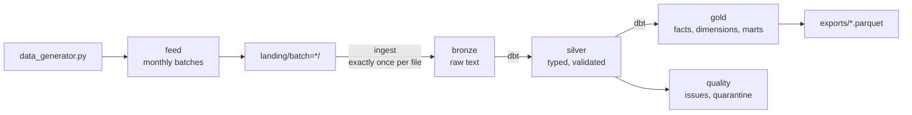

# Carton Caps analytics pipeline

A local prototype of the analytics pipeline for Carton Caps: it generates realistic app data, lands it in dated batches, loads it into DuckDB, validates and models it with dbt, and produces the tables behind engagement, referral and school-fundraising reporting.

Everything runs on your machine. There are no cloud accounts or services, and nothing touches the network after `pip install`.

| Deliverable | Where |
|---|---|
| 1. Data generation | [`data_generator.py`](data_generator.py) (completed), its behaviour settings in [`generator_settings.json`](generator_settings.json), assumptions in [`docs/data_generation.md`](docs/data_generation.md) |
| 2. Architecture and design | [`docs/pipeline_spec.md`](docs/pipeline_spec.md) |
| 3. Working pipeline | [`pipeline/`](pipeline) (Python steps and CLI), [`transform/`](transform) (dbt project), [`analysis/sample_queries.sql`](analysis/sample_queries.sql), [`tests/`](tests) |

## Quick start

Requires Python 3.10 or later. Runs on Windows, macOS and Linux.

```bash
python -m venv .venv
source .venv/bin/activate            # Windows: .venv\Scripts\activate
pip install -r requirements.txt

python -m pipeline run               # generate → feed → ingest → dbt build → export (about 12 s)
python -m pipeline report            # run the sample queries and print the results
python -m pytest                     # 38 tests (about 40 s)
```

`run` always starts from a clean warehouse. It prints a summary like this:

```
purchases: 9,983 records, 67 quarantined
referrals: 1,000 invites, 10 quarantined
funds raised for schools: $2,442.81
timings: generate 0.3s, feed 0.1s, ingest 2.7s, transform (dbt build) 9.3s, export 0.1s
```

## Commands

| Command | What it does |
|---|---|
| `python -m pipeline run [--scale N] [--cadence single]` | Full pipeline from a clean warehouse. `--scale 100` runs 100x the default volume |
| `python -m pipeline demo-incremental` | Loads the first three-quarters of the monthly batches (14 of 19) and builds, then loads the other 5 and builds incrementally, then checks every table against a full rebuild |
| `python -m pipeline report` | Runs [`analysis/sample_queries.sql`](analysis/sample_queries.sql) |
| `python -m pipeline generate` / `feed` / `ingest [--upto DATE]` / `transform [--full-refresh]` / `export` | The individual steps |

Output files go under the repo root (`data/`, `landing/`, `warehouse/`, `exports/`, all git-ignored), or under `$CARTON_CAPS_HOME` if you set it.

## How it works



1. **Feed** (`pipeline/feed.py`) splits the generator's output into monthly batches (19 for the default data, December 2022 to June 2024), the way data would arrive from production. Schools, users, products and districts (income by school district, reference data) arrive as full snapshots; purchases as new rows; referrals as new or changed rows (an invite can arrive as `clicked`, then again as `converted`).
2. **Ingest** (`pipeline/ingest.py`) loads each batch into `bronze` in one transaction. It skips files it has already loaded, rejects a batch whose file header doesn't match the expected columns, and rejects a file that changed after it was loaded. Everything lands as text, so a bad value becomes a data-quality finding rather than a failed load.
3. **Silver** (dbt) types every row and runs 27 data-quality checks. Each failing record is **dropped** (exact duplicate copies), **quarantined** (orphan product, bad quantity, purchase before signup, self-referral and so on), **repaired** (points that don't match the points rule), or **flagged** (two users sharing an email). Quarantined records are re-checked every run, so a purchase that arrives before its user's record isn't lost. The check catalog is [`transform/seeds/dq_check_catalog.csv`](transform/seeds/dq_check_catalog.csv).
4. **Gold** (dbt) builds dimensions, facts and ten reporting tables, including spending by district income level and user type. Silver purchases and referrals and the daily school table update incrementally; `demo-incremental` and the tests confirm the result equals a full rebuild.

The full design, including scaling, monitoring, the AWS deployment and privacy, is in [`docs/pipeline_spec.md`](docs/pipeline_spec.md).

## What you can query

The warehouse is `warehouse/carton_caps.duckdb`. Open it from Python:

```python
import duckdb
con = duckdb.connect('warehouse/carton_caps.duckdb')
con.sql('select * from gold.school_fundraising_leaderboard order by month desc, monthly_rank limit 10').show()
```

or with the [DuckDB CLI](https://duckdb.org/docs/installation/) (`duckdb warehouse/carton_caps.duckdb`). Every gold and quality table is also written to `exports/<schema>/<table>.parquet`.

The file is written in DuckDB's v1.0 storage format, so editor extensions and other tools built on DuckDB 1.x can open it as well as 2.0. Close or detach it in those tools before re-running the pipeline: `run` deletes and recreates the warehouse, and DuckDB allows only one process to write to the file at a time.

| Table | Grain | Answers |
|---|---|---|
| `gold.school_daily_activity` | school × day | Daily active users, new signups, purchases, spend and dollars raised |
| `gold.school_engagement_monthly` | school × month | MAU, average DAU, stickiness, cumulative funds raised |
| `gold.school_fundraising_leaderboard` | school × month | Monthly and cumulative rank, rank movement, dollars per active user |
| `gold.cohort_retention` | signup month × channel × months since signup | Retention for organic vs referred users, cumulative dollars raised per user |
| `gold.referral_funnel_monthly` | month sent × referrer segment | Invites → clicked → converted → qualified, bonus cost, funds raised by referred users |
| `gold.referrer_leaderboard` | referrer | Direct referrals plus the whole downstream network each referrer started |
| `gold.referral_growth_monthly` | month | Referral share of signups, invites per active user, viral coefficient (K) |
| `gold.product_category_monthly` | month × category × user type | Units, spend, buyers, share of spend, growth |
| `gold.purchase_time_heatmap` | day of week × hour | When people shop (purchases per hour) |
| `gold.spending_by_segment` | district income level × user type | Purchases per buyer, units and spend per purchase, average list price, promo share, dollars raised per user |
| `gold.dim_users`, `dim_schools`, `dim_products`, `dim_date` | | Dimensions. `dim_users` includes acquisition channel and referral generation; `dim_schools` includes the district and its income level |
| `gold.fct_purchases`, `fct_referrals`, `fct_user_activity_daily` | | Facts behind the tables above |
| `quality.dq_summary`, `dq_issues`, `quarantine_*` | | What was caught, and what is held back |

"Active" means a valid purchase or a referral invite sent that day. Dollars raised are points ÷ 100. A referral is "qualified" when the new user makes a purchase within 30 days, which earns $5 for each side. All of these are dbt variables in [`transform/dbt_project.yml`](transform/dbt_project.yml).

## Sample results

From `python -m pipeline report` on the default dataset:

```
## Spending by district income level and user type

income_level  user_type  buying_users  purchases_per_buyer  units_per_purchase  avg_list_price_per_unit  spend_per_purchase  promo_share  dollars_raised_per_user
------------  ---------  ------------  -------------------  ------------------  -----------------------  ------------------  -----------  -----------------------
low           parent     216           12.1                 1.6                 4.71                     7.33                0.1454       1.97
low           supporter  23            15.09                1.3                 4.36                     5.47                0.1499       1.88
low           teacher    58            10.72                1.98                4.67                     9                   0.1495       2.03
middle        parent     262           12.49                1.61                5.69                     8.95                0.0957       2.61
middle        supporter  43            12.19                1.29                5.44                     6.92                0.0763       1.87
middle        teacher    85            11.56                2.03                5.74                     11.43               0.0814       2.92
high          parent     103           11.12                1.58                6.85                     10.68               0.0594       3.14
high          supporter  13            8.23                 1.35                7.07                     9.34                0.0748       1.81
high          teacher    24            12.63                2.01                6.97                     13.81               0.1023       3.35

## Retention by acquisition channel (2023 signup cohorts, share active k months after signup)

channel   users  month_1  month_3  month_6
--------  -----  -------  -------  -------
all       996    0.593    0.458    0.366
organic   827    0.595    0.447    0.365
referral  169    0.586    0.509    0.373

## Referral funnel by referrer volume (all months)

referrer_segment  invites  click_rate  conversion_rate  qualified  bonus_cost_usd  raised_by_referred_users
----------------  -------  ----------  ---------------  ---------  --------------  ------------------------
1-2 invites       172      0.5         0.209            29         290             94.01
10+ invites       381      0.396       0.068            24         240             71.8
3-9 invites       437      0.551       0.249            87         870             270.17
all               990      0.483       0.173            140        1,400           435.98

## Data quality: what the pipeline caught and what it did about it

entity     check_name             severity  action             records_affected  extra_copies_dropped
---------  ---------------------  --------  -----------------  ----------------  --------------------
purchases  exact_duplicate        warn      drop_extra_copies  17                17
purchases  non_positive_quantity  error     quarantine         17
purchases  orphan_product         error     quarantine         17
purchases  retry_duplicate        warn      quarantine         17
purchases  before_signup          error     quarantine         16
purchases  points_mismatch        warn      repair             16
referrals  converted_before_sent  error     quarantine         2
referrals  duplicate_send         warn      quarantine         2
referrals  existing_member        error     quarantine         2
referrals  self_referral          error     quarantine         2
referrals  status_inconsistent    error     quarantine         2
users      shared_email           warn      flag               4
```

What the data shows:
- Spending rises with district income. Within every user type, a purchase in a high-income district is worth more than in a low-income one (parents: $10.68 against $7.33), because people there pick pricier products and use promotions less. Teachers buy about 2 units per purchase, against 1.3 for supporters.
- Retention declines gradually: 59% of 2023 signups are active in their first month after signup, 46% in month 3 and 37% in month 6. Referred users run slightly ahead (51% vs 45% in month 3), a modest effect of their 25% lower monthly churn.
- Mass invites convert poorly: invites from people who send ten or more convert at 7%, against 21–25% for everyone else.
- Over this window, referral bonuses ($1,400) cost more than the referred users raised for their schools ($436). That's a question for the business about lifetime value, not a data problem.
- January–June 2024 has no new signups and no invites, because the provided user generator places every signup in 2023. Monthly active users peak at 418 in December 2023 and fall to 242 by June 2024 as users churn.

## Tests

| Where | What |
|---|---|
| `tests/test_data_generator.py` | Generator invariants and realism: field contracts, no clean purchase before signup or product launch, points rule, heavy-tailed activity, weekend pattern, spending that varies by district income and user type, funnel rates, referral chains, reproducibility; every setting has a description, the settings file drives the data, and bad settings are rejected |
| `tests/test_feed_and_ingest.py` | Every purchase lands exactly once; snapshots grow; referrals arrive as change data; ingest is idempotent; schema drift and changed files are rejected with nothing partially loaded |
| `tests/test_pipeline.py` | End to end: every issue the generator planted is caught by the expected check, with no false positives. Funds raised, the referral funnel, retention and referral generations are recomputed independently from the generator's CSVs and must match. The spending table reflects income and user type. An incremental build equals a full rebuild |
| `transform/` (run by `dbt build`) | 3 dbt unit tests (duplicate, repair and quarantine logic; referral fraud checks; referral generations), about 65 schema tests, and 4 reconciliation tests (funds raised agree across layers, no record lost, funnel matches facts, every check catalogued) |

## Scale

| Run | Purchases | Users | Wall time | dbt build |
|---|---|---|---|---|
| Default | 10,000 | 1,000 | 12 s | 8 s |
| `--scale 10` | 100,000 | 10,000 | 18 s | 9 s |
| `--scale 100` | 1,000,000 | 100,000 | 85 s (45 s of it generating data) | 14 s |

Section 8.1 of the spec covers what changes beyond that.

## Project layout

```
data_generator.py           provided generator, completed (Deliverable 1)
generator_settings.json     every number that shapes the generated data, each with a description
docs/                       data_generation.md, pipeline_spec.md
pipeline/                   feed, ingest, transform (dbt runner), export, report, CLI
transform/                  dbt project
  models/silver/            *_typed (raw rows typed), *_checked (validated, incremental), *_current (latest state)
  models/gold/core/         dimensions and facts
  models/gold/marts/        reporting tables
  models/quality/           dq_issues, dq_summary, quarantine views
  seeds/                    dq_check_catalog.csv
  tests/                    reconciliation tests and unit-test fixtures
analysis/sample_queries.sql
tests/                      pytest suites
```

To browse model lineage, run `dbt docs generate && dbt docs serve` from `transform/` with `CARTON_CAPS_WAREHOUSE` set to the warehouse path.

## Notes

- The provided `Carton_Caps_Data.sqlite` isn't ingested. Its schema lacks points, categories, user types and referrals, and its rows don't share ids or dates with the generated data. [`docs/data_generation.md`](docs/data_generation.md) maps the two schemas.
- The generator's behaviour (activity segments, churn, district income, holidays, referral delays and so on) is set in `generator_settings.json`, so the assumptions can be read and changed without touching code. To try other values, copy the file and set `CARTON_CAPS_GENERATOR_SETTINGS` to the copy's path before `python -m pipeline run`.
- Two small fixes were made to the provided code: `generate_users` gives each signup a time of day instead of midnight, and `save_to_csv` writes UTF-8 (on Windows, Python's default is cp1252, which DuckDB can't read). The rest of the provided code is unchanged, including signups counting back from `start_date`. Its known bugs are listed in the data generation doc, along with how the pipeline handles each one.
- dbt is pinned to the pip-installable v1 line (dbt Core 1.12 with dbt-duckdb 1.11). The project also parses cleanly under dbt v2's parser (`dbt parse --use-v2-parser`).
- On Windows, if a run fails with "file in use" or "access denied", check whether the repo is in a OneDrive-synced folder (such as Desktop or Documents). OneDrive can briefly lock files while it syncs them. Moving the repo to a folder outside OneDrive, such as `C:\src`, avoids it.
