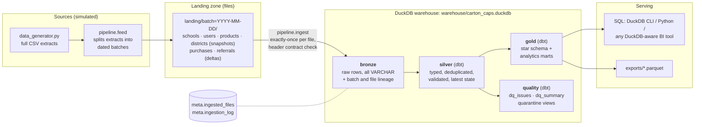
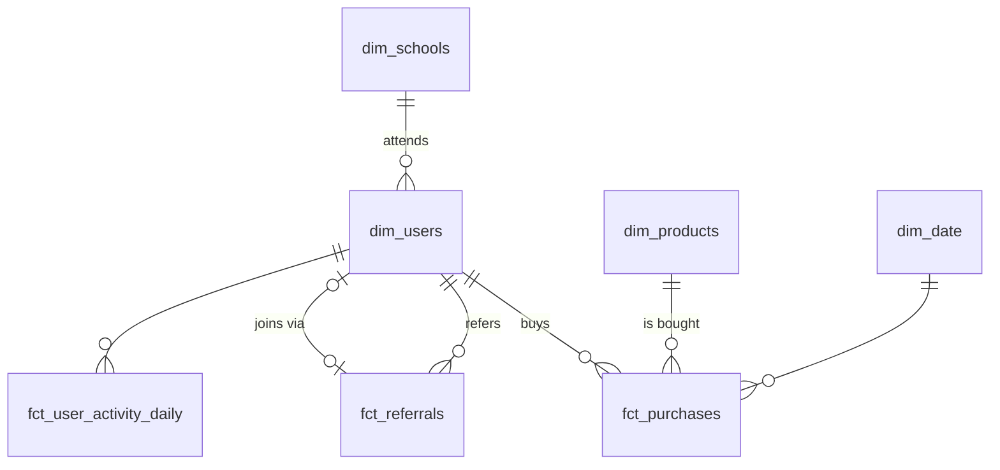
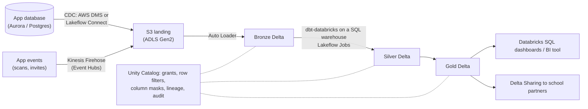

# Carton Caps analytics pipeline: technical specification

## 1. Purpose

Carton Caps needs to answer three kinds of question:

- **Engagement.** How many users are active per school, and do new users stick around?
- **Referral effectiveness.** Do invites turn into active members, what does each one cost in bonuses, and who drives growth?
- **Fundraising.** How much has each school raised, how is that changing, and which products and habits drive it?

The pipeline ingests the app's data, validates and models it, and serves analytical tables that answer these questions. The prototype runs on a laptop with one command. The design maps one-to-one onto a cloud lakehouse (section 8.3).

## 2. Architecture



| Stage | Component | What it does |
|---|---|---|
| Source | `data_generator.py` | Produces full extracts of the five app entities, plus `districts`: income level by school district, standing in for external reference data such as Census income. The behaviour assumptions behind the data (activity segments, churn, district income, holidays, referral delays) are set in `generator_settings.json` and explained in `docs/data_generation.md` |
| Source | `pipeline/feed.py` | Splits those extracts into dated batches, the way they would arrive from production. Small entities (schools, users, products, districts) come as full snapshots of every row that existed at the cutoff. Purchases come as deltas: rows in the window since the last cutoff. Referrals come as change data: rows that are new, or whose state changed, since the last cutoff. |
| Landing | `landing/batch=YYYY-MM-DD/*.csv` | Immutable files, one folder per batch. Monthly batches by default |
| Ingest | `pipeline/ingest.py` | Loads each landing file that isn't yet in `meta.ingested_files` into its bronze table, in one transaction per batch. Rejects files whose header doesn't match the contract |
| Bronze | `bronze.<entity>` | Append-only raw rows stored as VARCHAR, plus `_batch_id`, `_source_file`, `_row_number` and `_ingested_at` |
| Silver | dbt `silver` schema | Casts types, collapses snapshots and change data to the latest state, deduplicates, and runs every validation check. Bad rows are quarantined with a reason code rather than dropped |
| Gold | dbt `gold` schema | Conformed dimensions, facts and the analytics marts in section 4 |
| Quality | dbt `quality` schema | One row per detected issue, a summary by check, and quarantine views |
| Serving | DuckDB file + Parquet | Gold is queryable in place and exported to Parquet for other tools |

One CLI drives every step: `python -m pipeline run` generates, feeds, ingests, runs `dbt build` (models plus tests) and exports. Each step can also run on its own (section 6).

## 3. Technology choices

| Choice | Why | Trade-off |
|---|---|---|
| **DuckDB** as the warehouse engine | In-process with nothing to install beyond pip. Columnar and fast at this scale and well past 100x. Reads CSV and Parquet natively. Its SQL ports to Spark SQL with few changes | Single writer and a single machine, so it isn't a multi-user production warehouse. Section 8.3 replaces it |
| **dbt Core 1.12 + dbt-duckdb 1.11** for transformations | SQL models with explicit dependencies, incremental materializations (`merge`, `delete+insert`), data tests and unit tests in one tool, plus generated docs and lineage. The same project runs on Databricks by swapping the adapter | One more tool to learn. Pinned to the pip-installable v1 line. dbt v2, released in September 2026, ships its own DuckDB adapter as a compiled binary. The project already parses cleanly with dbt 1.12's opt-in v2 parser (`dbt parse --use-v2-parser`), so the move is ready when the ecosystem settles |
| **Python stdlib + DuckDB** for feed and ingest | Ingestion is a boundary that should be explicit, testable and independent of dbt: exactly-once file tracking and header contract checks. This mirrors what Databricks Auto Loader does in production | A small amount of custom code instead of a managed service |
| **CSV landing files** | That's what the provided generator writes. Bronze keeps the raw strings, so a type problem becomes a data-quality issue instead of an ingest failure | No embedded schema. Production would land Parquet or JSON from CDC |
| **pytest** | Tests for the generator, ingestion idempotency, an end-to-end run that checks every planted issue is caught, and a check that an incremental build matches a full rebuild | None |
| **No orchestrator locally** | The CLI runs the steps in order and dbt handles ordering within the transform step, so Airflow or Dagster would add setup without adding behaviour. Section 8.3 covers orchestration | Retries and scheduling are out of scope for the prototype |

Alternatives considered: PySpark with local Delta Lake would mirror the production stack most closely, but every reviewer would need Java, and Spark is slower than DuckDB on data this small. Plain Python with SQL files would be lighter, but it would rebuild what dbt provides (dependency graph, incremental logic, tests and docs).

## 4. Schema design

### 4.1 Layers and naming

| Schema | Built by | Contents |
|---|---|---|
| `meta` | ingest | `ingested_files` (path, checksum, batch, row count, ingested_at) and `ingestion_log` (per-file outcome, including rejections) |
| `bronze` | ingest | `schools`, `users`, `products`, `districts`, `purchases`, `referrals` as raw, append-only rows |
| `silver` | dbt | `*_current` (the latest cleaned state of schools, users, products and districts), `purchases_typed` / `referrals_typed` (every bronze row with types applied, duplicates included) and `purchases_checked` / `referrals_checked` (one row per record with its DQ status) |
| `gold` | dbt | `dim_*`, `fct_*` and the analytics marts |
| `quality` | dbt | `dq_check_catalog` (a seed listing every check with its severity and action), `dq_issues`, `dq_summary`, `quarantine_purchases`, `quarantine_referrals` |

The schema names the layer, so silver models are named for the state of their data: `_typed`, `_checked` or `_current`. Gold uses the dimensional-modeling prefixes `dim_` and `fct_`, which describe a table's shape rather than a pipeline stage.

### 4.2 Core star schema (gold)



| Table | Grain | Key columns | Notable columns |
|---|---|---|---|
| `dim_schools` | school | `school_id` | name, city, state, district, income_level, median_household_income, created_at |
| `dim_users` | user | `user_id` | school_id, user_type, signup_at, signup_cohort_month, acquisition_channel (`organic` / `referral`), referrer_user_id, referral_generation (0 = organic), first_purchase_at, is_activated, email_hash (no raw email), has_shared_email |
| `dim_products` | product | `product_id` | name, category, list_price, points_per_dollar, launched_at |
| `dim_date` | day | `date_day` | week_start, month_start, day_name, is_weekend, school_year (August to July, for example `2023-24`) |
| `fct_purchases` | one valid purchase (one product, any quantity) | `purchase_id` | user_id, school_id, user_type, product_id, category, purchased_at, quantity, list_amount, price_paid, discount_amount, is_promo, points_earned (recomputed by rule), points_reported (from source), dollars_raised |
| `fct_referrals` | one valid invite | `referral_id` | referrer_user_id, referrer_school_id, referrer_segment (by invite volume), referred_user_id, referred_email_hash, sent_at, converted_at, is_clicked, is_converted, is_qualified, is_qualification_window_complete, qualified_at, hours_to_convert, is_same_school, is_assist, bonus_usd |
| `fct_user_activity_daily` | user × day with any activity | `user_id, activity_date` | school_id, purchases, spend, points_earned, dollars_raised, referrals_sent |

### 4.3 Analytics marts (gold)

| Mart | Grain | Answers |
|---|---|---|
| `school_daily_activity` | school × day | DAU, new signups, purchases, spend, points and dollars raised per school per day |
| `school_engagement_monthly` | school × month | MAU, average DAU, stickiness (average DAU ÷ MAU), new users |
| `school_fundraising_leaderboard` | school × month | Dollars raised, rank in the month, change in rank, cumulative total and rank, dollars per active user, share of all funds raised |
| `cohort_retention` | signup month × channel × months since signup | Cohort size, active users, retention rate, cumulative dollars raised per user (a lifetime-value proxy). Only fully observed months are included |
| `referral_funnel_monthly` | month sent × referrer segment | Invites → clicked → converted → qualified, with rates, median hours to convert, bonus cost, and what the referred users raised per bonus dollar. The qualification rate counts only conversions whose 30-day window has closed |
| `referrer_leaderboard` | referrer | Invites, conversions, conversion rate, direct referrals, total downstream network, deepest chain, and funds raised by the referrer's network |
| `referral_growth_monthly` | month | Active users, invites per active user, conversion rate, viral coefficient (K), and the referral share of signups |
| `product_category_monthly` | month × category × user type | Lines, units, spend, buyers, share of spend, month-over-month growth |
| `purchase_time_heatmap` | day of week × hour | Purchases and share of purchases |
| `spending_by_segment` | district income level × user type | Buyers, purchases per buyer, units and spend per purchase, average list price, promo share, dollars raised per user |

### 4.4 Metric definitions

| Metric | Definition |
|---|---|
| Active user (DAU / MAU) | A user with at least one valid purchase or at least one referral invite sent in the day or month. A signup alone doesn't count |
| Dollars raised | Valid points ÷ 100, the business rule assumed in `docs/data_generation.md` |
| Retention, month *k* | Share of a signup cohort active in calendar month *cohort + k*. Month 0 is the signup month |
| Qualified referral | A converted referral whose new user makes a valid purchase within 30 days of signup: the rules' "qualifying action", with an assumed 30-day window. Conversions in the last 30 days of data can't be judged yet, so qualification rates exclude them |
| Bonus cost | $5 to the referrer plus $5 to the new user per qualified referral |
| Viral coefficient (K) | Invites per active user in the month × conversion rate of those invites, which equals converted invites ÷ active users |
| Assist | A valid invite to someone who later joined through a different referrer's invite. Credit goes to the converting invite (last touch) |

## 5. Data quality and validation

### 5.1 Where checks run

| Layer | Checks | On failure |
|---|---|---|
| Ingest | The file's header matches the column contract; the file hasn't been loaded already (checksum); the row count is recorded | The whole batch is rejected and logged in `meta.ingestion_log`. Nothing partial lands |
| Silver | Type casts, primary keys, referential integrity, valid values and ranges, cross-field business rules, duplicates | Per-row policy: drop, quarantine, repair or flag (5.2). Every action is logged in `quality.dq_issues` |
| Gold | dbt tests: unique and not-null keys, relationships, accepted values, and reconciliations (for example, total points in the marts equal total valid points in silver) | `dbt build` fails, and no partly correct marts are published |

### 5.2 Silver checks and handling policy

| Entity | Check | Severity | Action |
|---|---|---|---|
| purchases | Same `purchase_id` arrives twice with identical content (replayed upload) | warn | **Drop** the extra copy |
| purchases | Same `purchase_id` arrives with different content | error | **Quarantine** every version |
| purchases | Same user, product, timestamp, quantity and amount under a new `purchase_id` (client retry) | warn | **Quarantine** the later id |
| purchases | Unparseable or missing key, timestamp or amount | error | **Quarantine** |
| purchases | `product_id` not in the catalog | error | **Quarantine** |
| purchases | `user_id` not in users | error | **Quarantine**, re-checked on every run (5.3) |
| purchases | The purchasing user is quarantined | error | **Quarantine** |
| purchases | Quantity ≤ 0 | error | **Quarantine** |
| purchases | `price_paid` ≤ 0, above the list amount, or below 50% of it | error | **Quarantine** |
| purchases | Purchased before the user signed up | error | **Quarantine** (the date can't be trusted) |
| purchases | Purchased after the batch cutoff (a future timestamp) | error | **Quarantine** |
| purchases | `points_earned` ≠ floor(price_paid × points_per_dollar) | warn | **Repair**: keep the row, use the rule value, and keep the source value as `points_reported` |
| purchases | `day_of_week` or `hour_of_day` disagree with `purchased_at` | warn | **Repair**: recompute from `purchased_at` |
| referrals | Unparseable or missing id, referrer, `sent_at` or status | error | **Quarantine** |
| referrals | Same `referral_id` twice in one batch with different content | error | **Quarantine** |
| referrals | Referrer not a valid user | error | **Quarantine**, re-checked on every run |
| referrals | `referred_user_id` not in users | error | **Quarantine**, re-checked on every run |
| referrals | Self-referral: invited email equals the referrer's email after lowercasing and removing any `+tag` | error | **Quarantine** |
| referrals | Status is `converted` but there's no referred user or `converted_at` (or the reverse) | error | **Quarantine** |
| referrals | Converted to someone who was a member before the invite was sent | error | **Quarantine** (ineligible under the rules) |
| referrals | `converted_at` earlier than `sent_at` | error | **Quarantine** |
| referrals | Same referrer and email within 24 hours (double send) | warn | **Quarantine** the later invite |
| referrals | Status outside `sent` / `clicked` / `converted` | error | **Quarantine** |
| users | Email shared by more than one user | warn | **Flag** both (`has_shared_email`); joins never use email |
| users | `school_id` not in schools; `user_type` not an accepted value; unparseable id or signup time | error | **Quarantine** the user, along with their purchases |
| all | Primary key duplicated within one snapshot | error | Fail the build |

The full list, with severities and actions, is the `dq_check_catalog` seed. The models look up which checks quarantine a record there rather than hard-coding them.

The generator plants 11 of these issue types and writes the ids of the planted rows to `data/injected_dq_issues.json`. An end-to-end test asserts that each planted row is caught by the expected check, that rows with repairable issues stay in gold, and that no clean row gets any issue at all.

### 5.3 Late-arriving dimensions

A purchase can arrive in a batch before its user does. In this data that happens to backdated receipts, which the generator plants; with monthly batches it occurs in 5 of the 19 batches. Silver quarantines such a row as `orphan_user`, and every run re-checks quarantined rows against the current dimensions. When the user arrives, the row's reason updates (here, to `before_signup`), or the row is released into the facts if it now passes. This keeps an incremental build identical to a full rebuild. That was checked by building after each of the 19 batches in turn, and a test runs the same comparison.

## 6. Incremental updates

| Layer | Strategy | Idempotency |
|---|---|---|
| Landing to bronze | Load only files absent from `meta.ingested_files`, keyed by path and SHA-256. One transaction per batch | Re-running ingest is a no-op. A changed file under an old name is rejected rather than reloaded |
| Silver, snapshots (schools, users, products, districts) | Rebuild from the latest batch's snapshot (SCD type 1). These tables are tiny | Deterministic from bronze |
| Silver, purchases (append-only events) | dbt `incremental`, `merge` on `purchase_id`. Each run re-evaluates records from new batches, currently quarantined records, and existing records sharing a natural key with a new one (so retries are caught across batches). Every raw copy of a re-evaluated record is re-read from bronze | Merge by key, so replays are harmless |
| Silver, referrals (mutable records) | dbt `incremental`, `merge` on `referral_id`, keeping the latest version by batch. Each run re-evaluates invites with a new version, quarantined invites, and earlier invites from the same referrer to the same address (for the double-send check) | Latest version wins |
| Gold, daily marts | `school_daily_activity`: dbt `incremental`, `delete+insert` of every school for each date touched by the run (dates of re-evaluated records and of new signups). Writing every school keeps a date whose activity drops to zero from going stale | Recomputing a date always gives the same result |
| Gold, other marts and dimensions | Full rebuild each run. They're cheap at this scale (section 8.1 covers 100x) | Deterministic |
| Backfill or logic change | `python -m pipeline transform --full-refresh` rebuilds silver and gold from bronze, which holds the full history | Same result as the incremental path |

`python -m pipeline demo-incremental` exercises this end to end. It ingests the first three-quarters of the monthly batches (14 of 19) and builds, then ingests the other 5 and builds incrementally, and compares all 26 silver, gold and quality tables with a full rebuild. In that run the incremental build re-evaluates 3,292 of 9,983 purchase records and 10 of 1,000 referrals (the quarantined ones; no new referrals arrive after January 2024), and every table matches.

## 7. Running it

```bash
pip install -r requirements.txt
python -m pipeline run                 # generate → feed → ingest → dbt build → export
python -m pipeline demo-incremental    # batch-by-batch run checked against a full rebuild
python -m pytest                       # generator, ingest, end-to-end and incremental tests
```

The README has setup details and sample queries.

## 8. Production considerations

### 8.1 Scaling to 100x

At 100x the default (100k users, 1M purchases and 100k referrals), the prototype stack still works. Measured with `python -m pipeline run --scale 100`:

| Run | Purchases | End to end | dbt build (104 models and tests) | Warehouse size |
|---|---|---|---|---|
| Default | 10,000 | 12 s | 8 s | 10 MB |
| 10x | 100,000 | 18 s | 9 s | 24 MB |
| 100x | 1,000,000 | 85 s, of which 45 s is data generation | 14 s | 172 MB |

The things that break first are concurrency and operations, not volume:

| Concern at 100x and beyond | Change |
|---|---|
| A single writer and a file-based database | Move to Delta tables on object storage (8.3): concurrent readers and writers, time travel, and `MERGE` at scale |
| Full rebuilds of facts | Make every fact and daily mart incremental. Rebuild by date partition, never the whole table |
| Scan cost on large facts | Partition purchases by `purchase_date` and cluster by `school_id` and `user_id` (liquid clustering on Delta) |
| Many small landing files | Batch or compact at ingest. Auto Loader with file notification instead of directory listing |
| Full user snapshots every batch | Bronze holds a copy of every user per batch (1.2M rows after 19 batches at 100x). Switch users to change data from the app database, as purchases and referrals already are |
| Re-checking quarantined rows | Bound it with a retention window (for example 30 days) and an alert if quarantine grows |
| Referral network walk (recursive CTE) | Chains only grow, so store each user's generation and root referrer when they join, rather than recomputing the whole graph |
| Daily-to-monthly roll-ups | Build monthly marts from the daily marts, not from raw facts |
| The generator itself | Stream rows to files instead of holding lists in memory; the provided school generator stops at 105 schools |

### 8.2 Monitoring and alerting

| Signal | Alert when |
|---|---|
| Pipeline run status and duration | A step fails, or runtime exceeds 2x its trailing median |
| Source freshness (newest batch per entity) | No new batch within the SLA, for example 26 hours for a daily feed |
| Volume | Rows per batch fall outside ±3 standard deviations of the trailing 28 batches, or are zero |
| Schema drift | Any file rejected for a header mismatch |
| Data quality | The quarantine rate for any check exceeds its threshold (for example 2% of purchases), or a new check starts firing |
| Reconciliation | Gold totals don't match silver (a dbt test fails) |
| Business guardrails | Referral conversion or DAU moves more than 30% week over week. These are often real changes, so they go to a channel rather than a pager |

Run metadata, `quality.dq_summary` and dbt's `run_results.json` are written to tables that a small observability dashboard reads.

### 8.3 Cloud deployment (AWS; Azure equivalents in parentheses)



| Prototype | AWS + Databricks |
|---|---|
| `pipeline/feed.py` | Real sources: CDC from the app database via AWS DMS or Lakeflow Connect; scan and invite events via Kinesis Firehose (Azure: Event Hubs) to S3 (Azure: ADLS Gen2) |
| `pipeline/ingest.py` and `meta.ingested_files` | Auto Loader into bronze Delta tables. Checkpoints give exactly-once ingestion; the rescued-data column captures schema drift |
| DuckDB file | Delta tables in Unity Catalog: a catalog per environment (`dev`, `staging`, `prod`) with `bronze`, `silver`, `gold` and `quality` schemas |
| dbt-duckdb | The same dbt project on dbt-databricks against a serverless SQL warehouse. Incremental `merge` becomes Delta `MERGE` |
| `python -m pipeline run` | A Lakeflow Job (Azure Databricks Workflows, or Airflow on MWAA if the company standardizes on it): ingest task → dbt task → export and alerts, with retries and SLAs |
| Parquet exports | Databricks SQL dashboards or the company's BI tool; Delta Sharing for school-partner reporting |
| pytest locally | CI on every merge request: lint, unit tests, and `dbt build` in a disposable schema, deferring to production state. Deployed with Databricks Asset Bundles; infrastructure (S3, IAM, Unity Catalog) in Terraform |
| Log tables | Job alerts and SQL alerts on `quality.dq_summary` and freshness, routed to Slack and PagerDuty |

Cost controls: serverless SQL with auto-stop, job compute for ingest, and incremental models so daily cost tracks new data rather than total history.

### 8.4 Data governance and privacy

| Area | Approach |
|---|---|
| PII inventory | Direct identifiers are user names and emails, plus the email addresses of people who were invited but never joined. Behavioural data is purchase history, tied to a school. School records are public |
| Minimization | Silver replaces emails with a keyed hash of the normalized address, which is enough for duplicate and self-referral checks, and drops names. Gold holds no names or emails. Raw emails stay only in restricted bronze. The prototype uses SHA-256 with a salt from `CARTON_CAPS_EMAIL_SALT`; production would use HMAC-SHA-256 with the key in a secret store |
| People who never joined | Invited addresses belong to people who never agreed to anything. Unconverted invites are hashed in silver and deleted from bronze after 90 days |
| Children | Members are adults (parents, teachers, supporters), and no student records are collected, so FERPA doesn't apply. If the app ever allowed users under 13, COPPA would require parental consent and data-handling changes upstream |
| Access | Role-based grants in Unity Catalog: engineers on bronze and silver; analysts on gold; partner-facing views restricted to one school by row filters. Groups of fewer than 5 users are suppressed in anything shared outside the company |
| Rights requests (CCPA/CPRA and other state laws) | Deletions by `user_id` propagate through bronze (Delta `DELETE`, then `VACUUM` after the retention window), silver and gold. A suppression list stops a re-ingested record from coming back |
| Security and audit | Encryption at rest (SSE-KMS) and in transit; secrets in Databricks secret scopes; Unity Catalog audit logs and lineage; changes deployed only through CI/CD with review, which supports SOC 2 change-management controls |
| Fraud data | Self-referral and ineligible-conversion flags feed fraud review. The rules PDF reserves the right to withhold rewards |

## 9. Key decisions and trade-offs

| Decision | Alternative | Why |
|---|---|---|
| Treat the generator's output as the source contract | The schema in `Carton_Caps_Data.sqlite` | The provided schema lacks points, categories, user types and referrals, all of which the required outputs need |
| DuckDB + dbt locally | PySpark + Delta locally | One `pip install` for reviewers, and fast on this data. The SQL and dbt project carry over to Databricks |
| An explicit ingest step with a file manifest | Pointing dbt at the CSVs | Gives an ingestion boundary with exactly-once semantics and contract checks, and keeps a batch history to build incrementally from |
| Bronze stores raw strings | Typed bronze | Nothing is lost at ingest; a bad value becomes a quarantined row instead of a failed load |
| Quarantine and continue | Fail the whole run on bad rows | One bad receipt shouldn't block every school's numbers. Structural problems (schema drift, duplicate primary keys in a snapshot) still fail fast |
| Repair where the truth is derivable | Quarantine everything | Points follow a deterministic rule and time fields derive from the timestamp, so recomputing them is safer than dropping a real purchase |
| Re-check quarantined rows every run | Never revisit | Handles late-arriving users and keeps incremental results equal to a full rebuild |
| Referrals as mutable records merged to their latest state | An append-only log of status events | The source contract has no `clicked_at` or status history, so latest state is all that exists. An event log is on the evolution path |
| Silver models named for the state of their data (`_typed`, `_checked`, `_current`) | dbt's `stg_` and `int_` prefixes | In a medallion lakehouse, "staging" usually means the raw landing area, which is bronze here. dbt's prefixes also didn't fit the roles: the main silver tables, which gold and quality read, would have carried the "intermediate" label dbt reserves for internal steps |
| Dimensions as SCD type 1 | SCD type 2 | Nobody changes school or user type in this data. School transfers would need type 2 in production |
| Last-touch referral attribution | First touch or multi-touch | The rules credit the code used at signup. Earlier invites are tracked as assists |

## 10. Assumptions and constraints

- Business rules are assumptions, documented in `docs/data_generation.md` and section 4.4. Points to dollars, the bonus amount and the 30-day qualification window are dbt variables in `transform/dbt_project.yml`, so each is a one-line change. The qualifying action (a first valid purchase) is defined in `fct_referrals`.
- The generated data's behaviour (activity segments, monthly churn, district income, holidays, referral delays) comes from `generator_settings.json`. Those numbers are assumptions, not measurements. The pipeline reads only the generated files, never the settings.
- Monthly landing batches. The design is the same at daily or hourly cadence, only the batch folders change.
- The provided generator places every signup in 2023, before the January–June 2024 window. History therefore starts at each signup (18 months in all), and the 2024 months show the established user base with no new signups or referral activity.
- Timestamps are naive and treated as one time zone.
- The provided `Carton_Caps_Data.sqlite` isn't ingested: its 34 users and 484 chatbot messages don't share ids or dates with the generated data.
- Data volume is small enough that gold marts other than the daily ones rebuild fully on every run.

## 11. Evolution path

1. **Prototype (this repo).** Batch pipeline, DuckDB and dbt, a quality framework with quarantine, and incremental silver.
2. **Cloud MVP.** The same dbt project on Databricks with Auto Loader ingestion, Unity Catalog, daily Lakeflow Jobs, CI/CD with Asset Bundles, and freshness and quality alerts.
3. **Fresher data and self-serve.** Stream scan and invite events for intraday DAU and fundraising tallies; school-partner dashboards through Delta Sharing; a semantic layer (dbt Semantic Layer or Databricks metric views) so "active user" means the same thing everywhere.
4. **New sources.** The chatbot's `Conversation_History` as an engagement signal, with LLM topic classification of user messages; referral status events with `clicked_at`, for true funnel timing; school-level campaigns, to measure their lift.
5. **Data products.** Churn prediction to target re-engagement, referral-propensity and fraud scoring, product recommendations, and A/B testing of bonus amounts. Each one builds on the gold layer, and some are pushed back to the app or CRM through reverse ETL.
